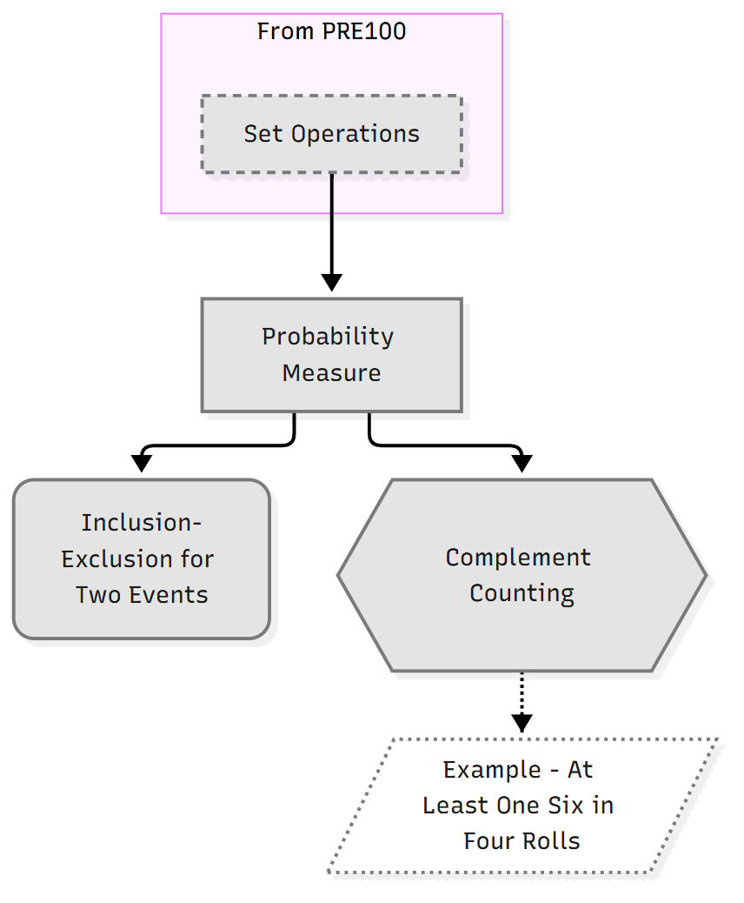

# obsidian-learning-loop

A **Claude Code plugin** that turns your Obsidian course notes into a Socratic tutor. It gives you a primer before each lecture, teaches one idea at a time from your own notes, makes you work every step, quizzes you to lock each idea in, and brings it back on a spaced schedule until you know it. An optional module adds what your lecturer said aloud, from Granola lecture transcripts.

It is for students (and anyone working through a technical course) who keep their notes in Obsidian and want to *learn* them, not just store them: mathematics, statistics, economics, finance and other subjects with definitions, results and methods.



*A module roadmap, generated from the notes' `depends_on` links. Colours show mastery (grey unseen, amber learning, blue secure, green mastered) and update after every session.*

## What you get

| Skill | What it does |
|---|---|
| `/learn:teach <course>` | Warm-up reviews, a primer for a new lecture, a probe for what you already know, a plan of at most three notes, then one idea at a time with a lock-in quiz. Advances only on a pass. |
| `/learn:quiz [course\|mixed]` | Pure retrieval over what is due, mixed across courses with topic labels hidden, plus redos of your logged mistakes. |
| `/learn:primer <course> <unit>` | A five-minute overview of a lecture or week: the question it answers, where it sits, its key ideas, and a prerequisite check. `/learn:primer week` gives the week ahead. |
| `/learn:roadmap [course]` | Dependency maps, a suggested order and a data-gaps report, built from your notes' `depends_on` links. |
| `/learn:ingest <file>` | Turns slides or notes into small linked notes (one definition, theorem, proof or method each), in your own words. |
| `/learn:lecture <course> <n>` | Optional: adds what the lecturer said aloud, from a transcript, to that lecture's notes. The slides stay the authority for formulas. |
| `/learn:query <question>` | Answers from your notes, with a link for every claim. |
| `/learn:lint` | A health check: broken links, theorems without proofs, failing primers, the review backlog. |

Behind the skills is a small Python engine that keeps the learner state (`unseen`, `learning`, `secure`, `mastered`) in each note's frontmatter, schedules reviews on a 1, 3, 7, 21, 60-day ladder, and draws the roadmaps. Nothing leaves your machine except what Claude Code itself sends.

## Quick start

1. Copy `vault-template/` somewhere and open it in Obsidian as a vault. Install Dataview.
2. `python -m pip install PyYAML networkx`
3. In a terminal in the vault folder, start `claude`, then:

   ```
   /plugin marketplace add <owner>/obsidian-learning-loop
   /plugin install learn@obsidian-learning-loop
   ```

4. Try the example course: `/learn:primer COURSE101 1`, then `/learn:teach COURSE101`.

Full steps, including your first real course: **[SETUP.md](SETUP.md)**.

## How it teaches

The loop is Eero Alvar's (probe, plan, teach one node, lock-in quiz), built on retrieval practice, spacing, interleaving, generation and hints rather than answers. [LEARNING-METHOD.md](LEARNING-METHOD.md) explains each piece and its evidence. You tune it to yourself in `Courses/_learning/Teaching Style.md`, including a different style per course (proof-led, methods-led or applied), each matched to how that course is examined.

## Integrity

The AI tests; you learn. Hints before answers, problem sheets cited rather than solved, past papers used for exam format only, and your institution's rules on AI come first. Read [INTEGRITY.md](INTEGRITY.md) before using it for a course.

## Repository layout

```
.claude-plugin/marketplace.json   the plugin marketplace (this repository)
plugin/                           the Claude Code plugin "learn"
  skills/                         method, teach, quiz, primer, roadmap, ingest, lecture, query, lint
  engine/                         the Python engine (vl.py, vault_learning/, tests/)
vault-template/                   the empty vault to copy: CLAUDE.md, templates, learning files, example course
optional/granola/                 lecture transcripts: plugin setup, template, PRIVACY.md
SETUP.md  LEARNING-METHOD.md  INTEGRITY.md  THIRD-PARTY.md  LICENSE
```

## Credits

Built by James Lu. The learning loop is Eero Alvar's ([How I Use AI to Learn Things](https://youtu.be/kzcI5F4tGiU)); some of the teaching rules are adapted from [Alvarmethod](https://github.com/vasanthsreeram/Alvarmethod) under the MIT licence (see [THIRD-PARTY.md](THIRD-PARTY.md)).

MIT licence: see [LICENSE](LICENSE).
