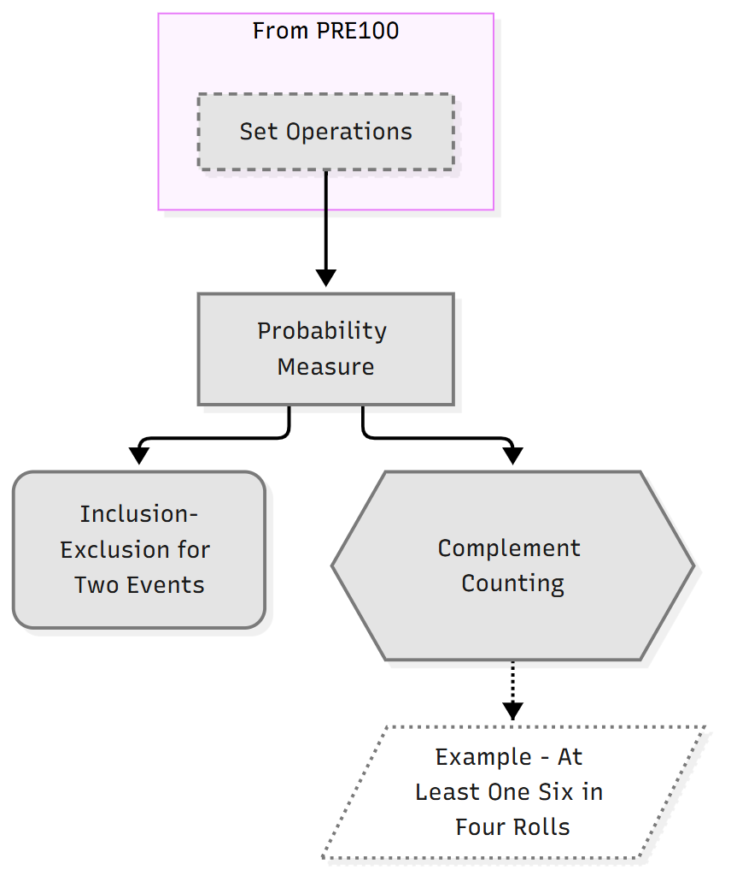

# Learning Stack

[](https://github.com/jlu1023/learning-stack/actions/workflows/tests.yml)

A **Claude Code plugin** that turns your notes into a Socratic tutor: in an Obsidian vault, or in any folder of PDFs, Markdown or photos of handwritten pages. It gives you a primer before each lecture, teaches one idea at a time from your own material, makes you work every step, quizzes you to lock each idea in, and brings it back on a spaced schedule until you know it. An optional module adds what your lecturer said aloud, from Granola lecture transcripts.

It is for students (and anyone working through a technical course) who want to *learn* their notes, not just store them: mathematics, statistics, economics, finance and other subjects with definitions, results and methods.



*A module roadmap, generated from the notes' `depends_on` links. Colours show mastery (grey unseen, amber learning, blue secure, green mastered) and update after every session.*

## Quick start

You need [Claude Code](https://code.claude.com) and Python 3.10 or later (most Macs and Linux machines have it; on Windows, get it from [python.org](https://www.python.org/downloads/)). Nothing else to install.

In Claude Code, in the folder you want to study in:

```
/plugin marketplace add jlu1023/learning-stack
/plugin install learn@learning-stack
/learn:setup
```

`/learn:setup` makes a new study vault there (with an optional example course), or connects the notes already in the folder without changing them. Then try `/learn:teach`. Full steps: **[SETUP.md](SETUP.md)**.

## Three ways to use it

| You have | Choose in `/learn:setup` | What happens |
|---|---|---|
| Obsidian, or you want it | A new vault, Obsidian | `/learn:ingest` turns your slides and notes into small linked notes; links, review tables and diagrams render in Obsidian. Recommended. |
| Any other editor (VS Code, Typora, a text editor) | A new vault, another editor | The same, with ordinary Markdown links and static review tables. |
| Your own folder of notes, in any structure | Use the notes in this folder | Your files are left exactly as they are. The plugin builds a separate deck of review cards in `_learn/` (or a folder you choose) that link back to your files, on the same spaced schedule. |

## What you get

| Skill | What it does |
|---|---|
| `/learn:setup` | Checks Python, then makes a vault or connects your notes. |
| `/learn:teach <course>` | Warm-up reviews, a primer for a new lecture, a probe for what you already know, a plan of at most three ideas, then one idea at a time, each locked in with quick recall questions. `test` runs a unit test; `proofs` runs the proof track, where you learn to write proofs through a fading scaffold. |
| `/learn:quiz [course\|mixed]` | Pure retrieval over what is due, mixed across courses with topic labels hidden, plus redos of your logged mistakes. |
| `/learn:primer <course> <unit>` | A five-minute overview of a lecture or week: the question it answers, where it sits, its key ideas, and a prerequisite check. `/learn:primer week` gives the week ahead. |
| `/learn:roadmap [course]` | Dependency maps, a suggested order and a data-gaps report, built from your notes' `depends_on` links. |
| `/learn:ingest <file or url>` | Turns a PDF (typed, scanned or maths-heavy), Markdown file, web page or photo of handwritten notes into small linked notes, in your own words. Word and PowerPoint work once saved as PDF. |
| `/learn:connect [folder]` | Connects your own folder of notes without changing it, and builds review cards that point back to your files. Problem sheets and past papers are cited, never solved. |
| `/learn:lecture <course> <n>` | Optional: adds what the lecturer said aloud, from a transcript, to that lecture's notes. The slides stay the authority for formulas. |
| `/learn:query <question>` | Answers from your notes, with a link for every claim. |
| `/learn:lint` | A health check: broken links, theorems without proofs, failing primers, the review backlog. |
| `/learn:app` | Optional: opens Study Desk, a local page in your browser with a tab per course, typeset maths and a progress table. |

Behind the skills is a small engine, standard-library Python only, that keeps the learner state (`unseen`, `learning`, `secure`, `mastered`), schedules reviews on a 1, 3, 7, 21, 60-day ladder, schedules each proof on its own track, and draws the roadmaps. It runs on your machine; Claude Code sends the notes it reads to Claude as usual.

## Using it without Obsidian

Choose "another editor" in `/learn:setup` (or set `frontend: plain` in `vault-learning.yaml`). Links become ordinary relative Markdown links that any editor and GitHub follow, diagrams stay as Mermaid blocks (drawn by GitHub, Typora and many editors), and the Review Queue becomes static tables that `/learn:roadmap` regenerates. See [SETUP.md](SETUP.md#using-it-without-obsidian).

## Using your own notes

Run `/learn:setup` (or `/learn:connect`) in your notes folder. It reads your Markdown, PDFs and photos where they are, never edits them, and writes review cards to `_learn/` (or, with `--state-dir`, to a folder outside a read-only, shared or synced library). Rerun `/learn:connect` after you add or change notes: it finds new and changed files. See [SETUP.md](SETUP.md#using-your-own-notes).

## Study Desk (optional app)

`/learn:app` opens Study Desk: a page in your browser, served from your own machine, for working through a session without the terminal's limits. It has one tab per course plus a General tab, each with its own conversation; a home page with one ruled table of progress per course (started, due, redos, secure, mastered); maths typeset with KaTeX and diagrams drawn with Mermaid; linked notes that open beside the chat; photos of handwritten working pasted or dropped in; a style editor (themes, colours, fonts, sizes); and a status line with the model, the effort and your Claude usage limits.

It is a shell and adds no teaching rules. The tutor in each tab is Claude Code itself, started in your study folder, following the same skills and the same engine, so it uses Claude Code exactly as you have it installed and signed in. The server is standard-library Python and the page's libraries ship with the plugin, so there is still nothing to install and the page loads nothing from the network.

- **Start it:** `/learn:app` in Claude Code, or from your study folder `python3 <plugin>/app/serve.py` (on Windows `py -3 <plugin>\app\serve.py`), with the plugin's folder (shown by `/plugin`) in place of `<plugin>`. It opens `http://127.0.0.1:8030`; a second launch only opens the browser. Stop it with `/learn:app stop` (or `serve.py --stop`).
- **Permissions, plainly:** the tutor in the app runs Claude Code in your study folder in permission mode `auto`, so **it reads and edits files and runs commands there without stopping to ask you** (a web page cannot show Claude Code's permission prompts). To change that, start it with `--permission-mode acceptEdits` (or `manual`, `dontAsk`, `plan`), or set `"permission_mode"` in the app's `config.json`; in those modes anything Claude Code would ask about is refused, so allow the engine command first ([SETUP.md](SETUP.md#permission-prompts)).
- **Only this computer:** the server listens on 127.0.0.1 and refuses requests from other web pages. It never writes into your notes; your style settings, photos of working and its log go in a per-user data folder (`%LOCALAPPDATA%\StudyDesk` on Windows, `~/Library/Application Support/StudyDesk` on macOS, `~/.local/share/study-desk` on Linux).
- **Windows shortcut:** `/learn:app shortcut` offers a "Study Desk" desktop shortcut that opens the app in its own window with no console.

More in [plugin/app/README.md](plugin/app/README.md). Study Desk is an independent project, not made or endorsed by Anthropic.

## How it teaches

The loop is Eero Alvar's (probe, plan, teach one node, lock in), built on retrieval practice, spacing, interleaving, generation and hints rather than answers. The probe brackets each prerequisite chain between what you know and what you miss; each step is predict, teach, check; reviews vary how each question is cued; and a quiet Learner Model keeps how you hold each idea, in your own words. Learning and recall are kept apart: lock-ins and reviews are quick recall, and writing proofs is practised on its own spaced track, from step by step to solo. [LEARNING-METHOD.md](LEARNING-METHOD.md) explains each piece and its evidence. You tune it to yourself in `Courses/_learning/Teaching Style.md`, including a different style per course (proof-led, methods-led or applied), each matched to how that course is examined.

## Integrity

The AI tests; you learn. Hints before answers, problem sheets and past papers cited rather than solved (also in your own connected notes), past papers used for exam format only, and your institution's rules on AI come first. Read [INTEGRITY.md](INTEGRITY.md) before using it for a course.

## Repository layout

```
.claude-plugin/marketplace.json   the plugin marketplace (this repository)
plugin/                           the Claude Code plugin "learn"
  skills/                         setup, method, teach, quiz, primer, roadmap, ingest, connect, lecture, query, lint, app
  engine/                         the engine: vl.py, vault_learning/ (standard library only), tests/
  app/                            Study Desk, the optional local app: serve.py, studydesk/, static/, windows/, tests/
  vault-template/                 what /learn:setup copies: CLAUDE.md, templates, learning files, example course
optional/granola/                 lecture transcripts: plugin setup, template, PRIVACY.md
docs/                             the README image and a synthetic sample handout to try /learn:ingest on
SETUP.md  LEARNING-METHOD.md  INTEGRITY.md  CONTRIBUTING.md  CHANGELOG.md  THIRD-PARTY.md  LICENSE
```

## Credits

Built by James Lu. The learning loop is Eero Alvar's ([How I Use AI to Learn Things](https://youtu.be/kzcI5F4tGiU)); some of the teaching rules are adapted from [Alvarmethod](https://github.com/vasanthsreeram/Alvarmethod) under the MIT licence, and some of the teaching ideas come from Eero Alvar's [LearnHarness](https://github.com/amosblomqvist/learnharness), rewritten in new words (see [THIRD-PARTY.md](THIRD-PARTY.md)).

MIT licence: see [LICENSE](LICENSE).
