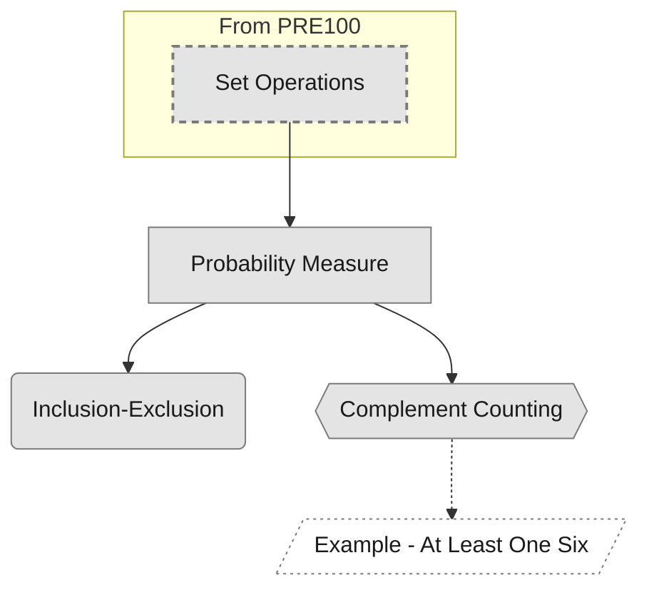

# 1 Axioms

What a probability is, formally: a function on events obeying three axioms, and the first rules that follow from them.

Overview: [[COURSE101 Lecture 1 Overview - Axioms]]

%% roadmap:start %%
## Roadmap

Generated by `/learn:roadmap` from `depends_on`; everything between the roadmap markers is overwritten on each run. Suggested order and data gaps: COURSE101 Roadmap.

Shapes: rectangle definition, rounded box theorem, hexagon method, stadium concept or intuition, double-sided box proof with no theorem note, slanted box example or evidence (dotted). Fills: grey unseen, amber learning, blue secure, green mastered. Dashed border: outside this module or course. Only nearest prerequisites are drawn: an arrow implied by a longer chain is left out. In Obsidian, click a node to open its note.
%% roadmap:end %%

## Definitions
- [[Probability Measure]]: a function on events satisfying Kolmogorov's three axioms

## Theorems
- [[Inclusion-Exclusion]]: $P(A \cup B) = P(A) + P(B) - P(A \cap B)$

## Proofs
- [[Proof - Inclusion-Exclusion]]

## Methods
- [[Complement Counting]]: compute $P(A)$ as $1 - P(A^c)$ when the complement is simpler

## Examples
- [[Example - At Least One Six]]

## Connections to other modules
- Depends on: [[Set Operations]]
- Feeds into: conditional probability (not yet written)
