# COURSE101 Roadmap

Generated by `/learn:roadmap` from the `depends_on` fields of the COURSE101 notes. Do not edit by hand: rerun `/learn:roadmap COURSE101` after every ingest, and after each `/learn:teach` or `/learn:quiz` session to refresh the colours. Course MOC: COURSE101 Syllabus. Module diagrams sit in each module MOC between the roadmap markers.

To hide roadmaps in the graph view, add `-file:Roadmap` to the graph's search filter.

Learner state: 3 nodes; 3 unseen, 0 learning, 0 secure, 0 mastered.

## Course map

One box per module. An arrow from A to B means notes in B depend on notes in A, and the number counts those dependencies. Arrows implied by a chain of other arrows are left out; every direct dependency is listed below the diagram.

```mermaid
flowchart TD
    n001["1 Axioms"]
    classDef unseen fill:#e4e4e4,stroke:#7a7a7a,color:#1a1a1a
    classDef learning fill:#f6cf72,stroke:#a86a12,color:#1a1a1a
    classDef secure fill:#9ec5f0,stroke:#2b5f9e,color:#1a1a1a
    classDef mastered fill:#9ad3a2,stroke:#2f7a4a,color:#1a1a1a
    classDef ext stroke-dasharray:5 4,stroke-width:2px
    classDef ctx fill:#f0f0f0,stroke:#7a7a7a,stroke-dasharray:5 4,color:#444444
    classDef example fill:#ffffff,stroke:#7a7a7a,stroke-dasharray:2 3,color:#1a1a1a
    classDef module fill:#e9edf4,stroke:#4f5f7a,color:#1a1a1a
    classDef course fill:#f0f0f0,stroke:#7a7a7a,stroke-dasharray:5 4,color:#1a1a1a
    class n001 module
    class n001 internal-link
```

Prerequisites from earlier courses, by module (details under Connections to other courses):

- PRE100: 1 Axioms (2)

## Spine

The results with the most dependents inside the course: what the rest of it hangs on. An arrow means the lower result builds on the upper one, directly or through others.

```mermaid
flowchart TD
    n001["Probability Measure"]
    classDef unseen fill:#e4e4e4,stroke:#7a7a7a,color:#1a1a1a
    classDef learning fill:#f6cf72,stroke:#a86a12,color:#1a1a1a
    classDef secure fill:#9ec5f0,stroke:#2b5f9e,color:#1a1a1a
    classDef mastered fill:#9ad3a2,stroke:#2f7a4a,color:#1a1a1a
    classDef ext stroke-dasharray:5 4,stroke-width:2px
    classDef ctx fill:#f0f0f0,stroke:#7a7a7a,stroke-dasharray:5 4,color:#444444
    classDef example fill:#ffffff,stroke:#7a7a7a,stroke-dasharray:2 3,color:#1a1a1a
    classDef module fill:#e9edf4,stroke:#4f5f7a,color:#1a1a1a
    classDef course fill:#f0f0f0,stroke:#7a7a7a,stroke-dasharray:5 4,color:#1a1a1a
    class n001 unseen
    class n001 internal-link
```

1. Probability Measure: 2 dependents

Shapes: rectangle definition, rounded box theorem, hexagon method, stadium concept or intuition, double-sided box proof with no theorem note, slanted box example or evidence (dotted). Fills: grey unseen, amber learning, blue secure, green mastered. Dashed border: outside this module or course. Only nearest prerequisites are drawn: an arrow implied by a longer chain is left out. In Obsidian, click a node to open its note.

## Suggested order

A prerequisite-first order within each module, in the course's module order. Plain names on purpose, so the roadmap adds no graph edges; open notes from the diagrams.

### 1 Axioms

1. Probability Measure
2. Inclusion-Exclusion (proof: Proof - Inclusion-Exclusion)
3. Complement Counting

## Connections to other courses

### Prerequisites from other courses

**PRE100**

- Set Operations: used by Inclusion-Exclusion, Probability Measure

### Where this course is used elsewhere

Nothing outside the course links in yet.

## Data gaps

How far to trust this map. The roadmap is only as good as the `depends_on` fields.

- Content notes: 5, of which 5 have `depends_on`.
- Diagram nodes: 3 (1 proofs folded into their theorems; 1 examples and evidence notes shown only in module diagrams).
- Prerequisite edges inside the course: 2. Edges to other courses: PRE100 2.
- Broken links: 0. Ambiguous links: 0. Cycles: 0.
- `used_in` entries with no matching `depends_on` on the target: 0 (listed below). `depends_on` entries with no matching `used_in` on the prerequisite: 0 (expected, since `used_in` is selective; not listed).
