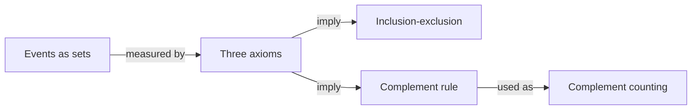

# COURSE101 Lecture 1 Overview - Probability Spaces

**The question:** what does it mean, precisely, to assign probabilities to events, and which rules follow without further assumptions?

## Where it sits
- Before: [[Set Operations]] gives the language of events. This lecture adds the axioms of a probability and the first two rules derived from them. Next: conditional probability (not yet written).

## Key ideas

1. Events are subsets of the sample space: [[Set Operations]]
2. A probability is a function on events obeying three axioms: [[Probability Measure]]
3. Overlaps are counted once: [[Inclusion-Exclusion for Two Events]]
4. "At least one" is easiest through its complement: [[Complement Counting]]

## Why it matters
- This example course has no Exam Profile, so there is no exam style to describe. In most courses, axiom-based derivations like these are classic bookwork.

## Before you start
1. (generated) For $A = \{1, 2\}$ and $B = \{2, 3\}$ in $\Omega = \{1, \dots, 6\}$, what are $A \cup B$, $A \cap B$ and $B \setminus A$? [[Set Operations]]
2. (generated) Which of these pairs are disjoint: $\{1\}$ and $\{2, 3\}$, or $\{1, 2\}$ and $\{2\}$? [[Set Operations]]
